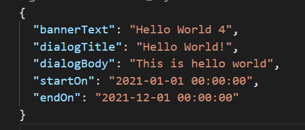
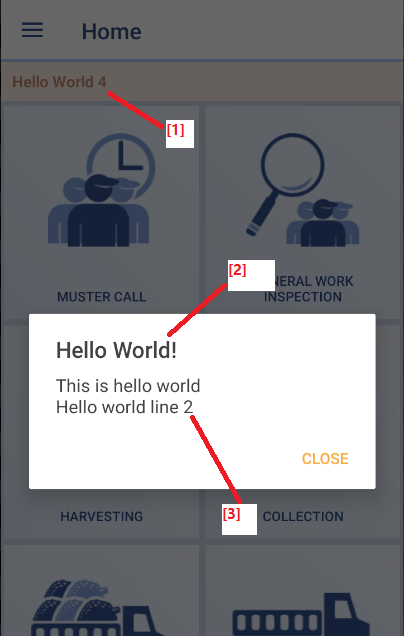

# quarto-connect-announcement

This repository serves as API endpoint of Quarto Connect app's announcement.

API hosted on [GitHub Pages](https://lintramax.github.io/quarto-connect-announcement/), append path `api/[variant]/announcement_v1.json` and it becomes app endpoints.


## API JSON scheme



- `bannerText {string}` - Title [1] of the announcement banner.
- `dialogTitle {string || null}` - Title of the dialog [2] 
- `dialogBody {string || null}` - Body of the dialog [3], supports multilines `\n`.
- `startOn {string}` - Announcement only appears after this date, format `yyyy-MM-dd HH:mm:ss` (UTC)
- `endOn {string}` - Announcement dissapear after this date, format `yyyy-MM-dd HH:mm:ss` (UTC)

** Strings are UTF-8 encoded.



## How to make new announcement for QC app?

1. Under this repo find `announcement_v1.json` in desired variant. e.g `api/release`
2. Update the json content accordingly.

App users will receive the announcement in their app once the update is reflected on GitHub Pages.

## When will app check for new announcement?

The checking is done at function `onResume()` of MainActivity.java.

## Announcement list (`announcement_list_v1.json`)

Every announcement users can read back from **Announcements** in the app's side panel. It sits next to `announcement_v1.json` in each variant folder (`api/[variant]/announcement_list_v1.json`). The app caches the last good copy, so the list still opens offline.

```json
{
  "announcements": [
    {
      "id": "v202611_newest_first_list",
      "publishedOn": "2026-10-14 00:00:00",
      "minVersionCode": 2611013,
      "title": { "en": "...", "ms": "...", "in": "..." },
      "body": { "en": "...", "ms": "...", "in": "..." }
    }
  ]
}
```

- `id {string}` - Unique key of the announcement. Never reuse one.
- `publishedOn {string}` - Shown from this date, format `yyyy-MM-dd HH:mm:ss` (UTC). A future date schedules it. The list is sorted newest first by this field.
- `minVersionCode {number || absent}` - Optional. Hidden from app versions below this code, for announcements about a feature older versions do not have.
- `title`, `body {object}` - Text per app language: `en` (English), `ms` (Malay), `in` (Indonesian; `id` also accepted). A missing language falls back to `en`, so `en` is required. `body` supports multilines `
`.

An entry missing `id`, `publishedOn` or the English `title`/`body` is skipped. A badly formatted date makes the whole file unreadable, so the app keeps showing its last cached copy - check the date format before pushing.

To add one, put a new entry in the `announcements` array of each variant you want it in.
