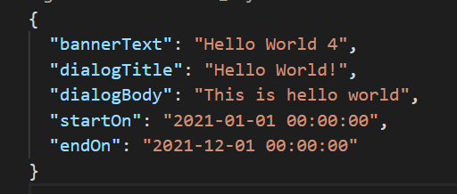
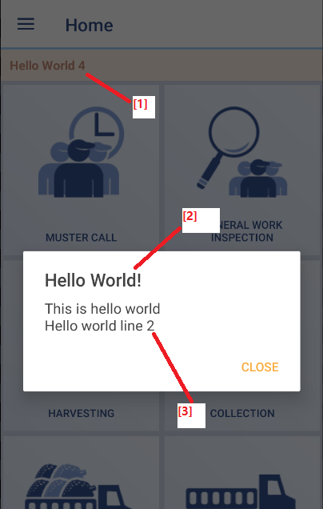

# quarto-connect-announcement

This repository serves as API endpoint of Quarto Connect app's announcement.

API hosted on [GitHub Pages](https://lintramax.github.io/quarto-connect-announcement/), append path `api/[variant]/announcement_v1.json` and it becomes app endpoints.


## API JSON scheme



- `bannerText {string}` - Title [1] of the announcement banner.
- `dialogTitle {string || null}` - Title of the dialog [2] 
- `dialogBody {string || null}` - Body of the dialog [3], supports multilines `\n`.
- `startOn {string}` - Announcement only appears after this date, format `yyyy-MM-dd HH:mm:ss` (UTC)
- `endOn {string}` - Announcement dissapear after this date, format `yyyy-MM-dd HH:mm:ss` (UTC)

** Strings are UTF-8 encoded.



## How to make new announcement for QC app?

1. Under this repo find `announcement_v1.json` in desired variant. e.g `api/release`
2. Update the json content accordingly.

App users will receive the announcement in their app once the update is reflected on GitHub Pages.

## When will app check for new announcement?

The checking is done at function `onResume()` of MainActivity.java.

## Announcement list (`announcement_list_v1.json`)

Every announcement users can read back from **Announcements** in the app's side panel. It sits next to `announcement_v1.json` in each variant folder (`api/[variant]/announcement_list_v1.json`). The app caches the last good copy, so the list still opens offline.

```json
{
  "announcements": [
    {
      "id": "v202611_newest_first_list",
      "versionCode": 2611005,
      "title": { "en": "...", "ms": "...", "in": "..." },
      "body": { "en": "...", "ms": "...", "in": "..." }
    }
  ]
}
```

- `id {string}` - Unique key of the announcement. Never reuse one.
- `versionCode {number}` - The app version the announcement belongs to, as a version code: `2611005` for v2026.11.005. The app groups the list under a header per version (`v2026.11.005`), newest version on top, and hides announcements from app versions below this code. Within one version, entries keep their order in this file.
- `title`, `body {object}` - Text per app language: `en` (English), `ms` (Malay), `in` (Indonesian; `id` also accepted). A missing language falls back to `en`, so `en` is required. `body` supports multilines `
`.

An entry missing `id`, `versionCode` or the English `title`/`body` is skipped. Invalid JSON makes the whole file unreadable, so the app keeps showing its last cached copy - validate the JSON before pushing.

### Editing the list: one source file, four generated files

**Do not edit `api/*/announcement_list_v1.json` by hand.** They are generated from a single source file, [`src/announcements.json`](src/announcements.json), where each entry also lists the variants it is published to:

```json
{
  "id": "v2611020_sync_fix",
  "versionCode": 2611020,
  "variants": ["debug", "qa"],
  "title": { "en": "...", "ms": "...", "in": "..." },
  "body": { "en": "...", "ms": "...", "in": "..." }
}
```

`variants` is only used to generate the files. The app files contain exactly the fields above (`id`, `versionCode`, `title`, `body`), at the same paths, so the app needs no change. To promote an announcement from qa to release, add `"release"` to its `variants`.

**With the editor (recommended)** - [Announcement Editor](https://lintramax.github.io/quarto-connect-announcement/editor/)

1. Open the editor in Chrome or Edge: use the link above, or double-click `editor/index.html` in your clone. Click **Open repo folder** and pick your local clone of this repo. (The Claude desktop app's preview pane shows a static copy of local files, so the editor can't run there.)
2. Edit the entries. The table shows which environments each announcement is in: click a square to publish to that environment or remove it from there. The square on a version row changes all of that version's entries at once. English, Malay and Indonesian sit side by side, and missing translations are flagged.
3. Click **Save to repo** (Ctrl+S). It writes `src/announcements.json` and the four variant files.
4. Review and commit in GitHub Desktop, then push.

Without opening a folder, the editor shows the published data read-only. **Download source** saves the edited `announcements.json` so you can build it by hand (below).

**By hand**

1. Edit `src/announcements.json`.
2. Run `node scripts/build.js`. It validates the source and rewrites the four variant files. Nothing is written if there are errors.
3. Commit the source and the generated files together.

The *Check announcements* GitHub Action runs `node scripts/build.js --check` on every push and pull request. It fails if the source is invalid or the generated files were not rebuilt or were edited by hand.

`announcement_v1.json` (banner/dialog) is still edited by hand.
